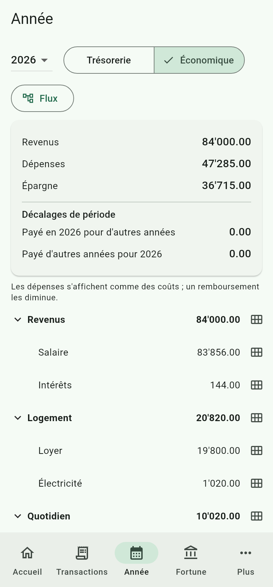
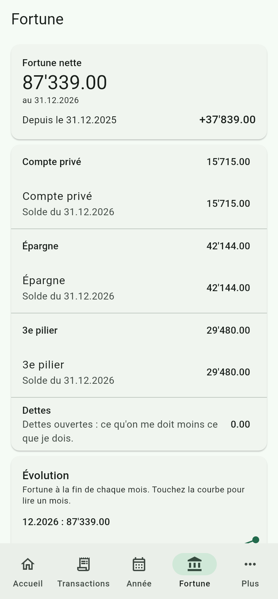
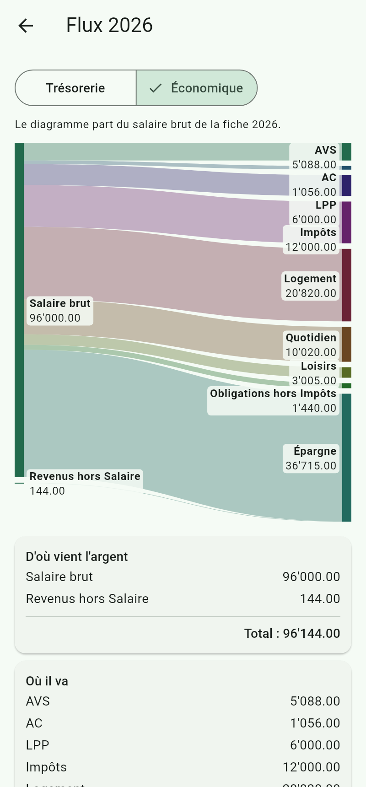
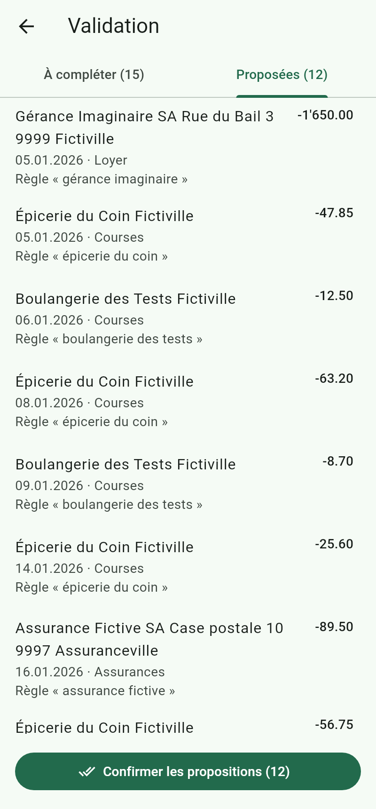

# batz

Personal accounting for one person: where the money goes, what each year
really costs, and how net worth evolves.

batz imports the monthly PDF statement of the bank, proposes a category for
each line from rules you write once, and keeps two views of every payment:
the day it was paid, and the period it is for. It runs fully offline on
Android, Windows and Ubuntu; a small server on your home network reads the
statements and keeps the reference copy of the data. Nothing leaves your
home, and there is no account to create.

**Status: alpha** (version 0.8.0-alpha). Everything the
[specification](docs/specification.md) plans for version 1.0 is there; the
version number will follow once it has been used for a while. The screens
are in French; the bank statements read are those of PostFinance, in Swiss
francs.

| « Année » | « Fortune » | Flow diagram | Validation |
|---|---|---|---|
|  |  |  |  |

The pictures show invented data (`batz-ui/tool/screenshots_test.dart`).

## What it does

- **Import and validation.** The statement of the month is sent to the
  server, which reads and checks it; its lines arrive « à valider », already
  classified by your mapping rules (keywords, a target category or account,
  a period model). Confirm the proposals in bulk, complete the rest, create a
  rule from a line. Validation works offline, on the phone.
- **Two views of a year.** The cash-flow view shows what was paid in the
  year; the economic view shows what the year cost: a payment that concerns
  twelve months from September counts four months this year and eight the
  next. A category tree per year, freely editable, month by month, with the
  transactions behind every amount; redistribution rules; refunds attached
  to their expense ([year view](docs/year-view.md)).
- **Net wealth.** Declare the balance of an account once or twice a year;
  the gap with the expected balance is a value variation, never an expense.
  The bank account follows its statements. Debts, a monthly curve, and for
  each year a table that explains the change of the wealth to the cent
  ([wealth](docs/wealth.md)).
- **Modules.** The annual salary sheet, a flow diagram from the gross
  salary to the taxes, the expenses and the savings, taxes by fiscal year
  with a control against what was paid, trips grouped by their dates,
  electricity per year with its kWh, subscriptions
  ([modules](docs/modules.md)).
- **Synchronisation.** Every device holds all the data and works offline.
  Modifications made on several devices combine field by field when they
  meet through the server; a lost device is revoked, a lost server is
  rebuilt from any device ([synchronisation](batz-web/docs/sync.md)).
- **Export.** Everything entered or imported, as a ZIP of CSV files a
  spreadsheet opens, made on any device, offline ([export](docs/export.md)).
- **Lock.** The Android app opens behind the lock of the phone; its local
  database is encrypted ([security](docs/security.md)).

## Install your own instance

batz is not a service: each person runs their own server and apps, with
their own data. You need a machine that runs Docker on your home network
(a NAS is enough; it may be switched off most of the time) and the files of
the [latest release](https://github.com/alkariin/batz/releases).

1. **Server.** Load the image `batz-web-<version>.tar.gz` and start the
   container: [deployment](batz-web/docs/deployment.md) gives the commands,
   and a script for a Synology NAS. The server creates its HTTPS
   certificate on its first start. Do not expose it to the Internet.
2. **Apps.** Android: add `https://github.com/alkariin/batz` to
   [Obtainium](https://github.com/ImranR98/Obtainium), or open the APK.
   Ubuntu and Windows: extract the archive and run `batz`.
3. **Pair each device.** On the server, `docker exec batz-web batz-web
   pairing-code` prints a code valid ten minutes and the fingerprint of the
   certificate. In the app: « Plus › Serveur », the address of the server,
   the code, a name for the device; compare the fingerprint shown with the
   printed one.

## First steps

1. « Plus › Comptes »: create your accounts. Enable the import of statements
   on the bank account: it becomes the *detailed* account, the one whose
   every line is imported.
2. « Plus › Catégories »: build the tree of the year, under groups of income
   and of expenses. batz comes with no tree: yours is the right one. It is
   copied to the next year at the first transaction dated there.
3. « Transactions »: import the first statement (at home, the server on).
   Complete its lines; create a rule each time a line will come back. The
   next statements arrive mostly classified.
4. « Fortune »: declare the balance of the other accounts (savings, pension,
   cash), with its date. Come back once or twice a year.
5. « Année » shows the year as it fills; « Plus › Analyses » holds the
   modules.

## Updating

A new version installs over the previous one and keeps its data: Obtainium
offers it on the phone; on a computer, extract the new archive. The server
is updated by loading the new image. Each release says whether the server
or the apps must go first; from 0.7.0 to 0.8.0-alpha the order is free.
[Deployment](batz-web/docs/deployment.md) has the details, and what to do
when a device or the server is lost: every app holds a full copy of the
data, so the server can always be rebuilt from one of them.

## Documentation

| Document | Content |
|---|---|
| [docs/specification.md](docs/specification.md) | Functional and technical specification (French). |
| [docs/year-view.md](docs/year-view.md) | How the annual view is computed, with examples. |
| [docs/wealth.md](docs/wealth.md) | Balances, debts, the wealth and the table that explains it. |
| [docs/modules.md](docs/modules.md) | Salary sheet, flow diagram, taxes, vacations, electricity, subscriptions. |
| [docs/export.md](docs/export.md) | The export: each file and its columns, the format. |
| [docs/security.md](docs/security.md) | What protects the data, and what does not. |
| [docs/decisions.md](docs/decisions.md) | Technical decisions and their evidence. |
| [docs/plan/](docs/plan/) | Phase plans and acceptance criteria (French). |
| [batz-web/docs/](batz-web/docs/) | Server: [architecture](batz-web/docs/architecture.md), [API](batz-web/docs/api.md), [synchronisation](batz-web/docs/sync.md), [import of statements](batz-web/docs/import.md), [deployment](batz-web/docs/deployment.md). |

| Folder | Content |
|---|---|
| `batz-ui/` | Flutter app (Android, Linux, Windows). |
| `batz-web/` | Go server, one container, HTTPS only. |
| `scripts/` | Repository checks: personal files and terms, real statements, release tag and build number. |

## Development

Requirements: Go 1.27, Flutter 3.47, Docker; for the Ubuntu build `clang`,
`cmake`, `ninja-build`, `pkg-config`, `libgtk-3-dev` and `libsecret-1-dev`;
the Android SDK and a JDK 17 for the APK.

```sh
# Server
cd batz-web/src
go vet ./... && go test -race ./...
BATZ_DATA_DIR=../data go run . serve       # https://localhost:8443
BATZ_DATA_DIR=../data go run . pairing-code
go run . extract internal/infrastructure/extraction/postfinance/testdata/2026-01.pdf
go test ./internal/infrastructure/extraction/postfinance/fake -update   # rewrite the test set

# App (its end-to-end tests build and start the server: Go must be on PATH,
# or BATZ_SERVER_BIN must point to a built batz-web)
cd batz-ui
flutter analyze && flutter test
flutter test benchmark/first_exchange_test.dart   # by hand: a first exchange of 20 000 entries
flutter test benchmark/journal_write_test.dart    # by hand: a modification of 1 000 fields
flutter test test/data/performance_test.dart      # alone: reload, views, wealth, modules and export with 10 000 transactions
flutter test tool/screenshots_test.dart           # by hand: the pictures of this page, from invented data
dart run tool/make_icons.dart                     # by hand: every icon file, from one drawing
flutter run -d linux
```

The extraction of statements needs `pdftotext` (`poppler-utils`) on PATH.

CI (`.github/workflows/ci.yml`) runs all of this, plus the Windows, Ubuntu and
Android builds, and a check of the server image that extracts the test set
inside it (`batz-web/scripts/check-image-extraction.sh`), on every change.
Releasing is described in [deployment](batz-web/docs/deployment.md).

## Personal data

Bank statements, personal mapping configurations, exports and signing keys
are never committed. `scripts/check-personal-files.sh` fails if git tracks
such a file; CI runs it on every change. With a local `personal/terms.txt`
(never committed: names, address, account and card numbers, one per line),
it also fails if one of those terms appears in a tracked file, the text of
PDF files included, or in a commit message.

Real statements kept at the root of the repository serve only local checks:
`scripts/check-real-statements.sh` extracts each and prints only its verdict
and number of lines, and compares dates and amounts with the CSV of the
original script when there is one. The test set is fictitious, written by a
generator (`batz-web/src/internal/infrastructure/extraction/postfinance/fake`).

## Licence

MIT, see `LICENSE`.
